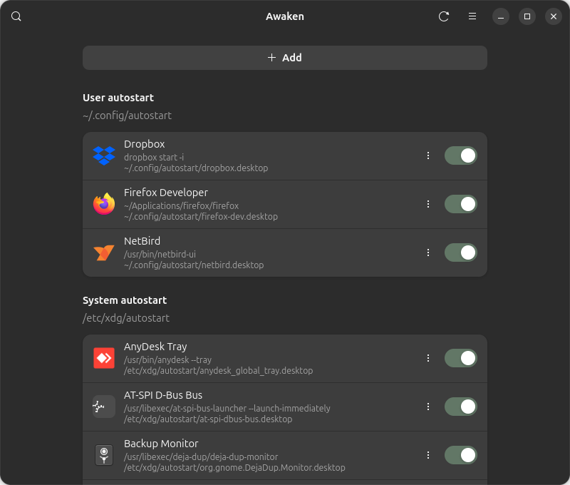
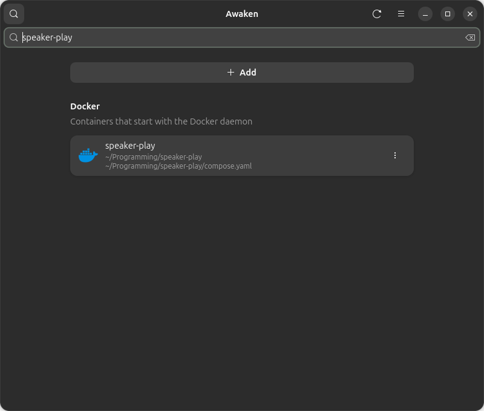

# Awaken

Awaken shows you what starts when you turn on your computer.

You will see your startup applications, the background services that start with the computer, and Docker projects that come back when Docker starts. Each one shows its name, its icon, and where it lives.

Turn the switch off to stop something from starting next time. Turn it on to bring it back. Use **Add** to create a new startup application.

**Screencast:**
https://github.com/martinszeltins/Awaken/raw/refs/heads/master/screencast8245.mp4





## Install

1. Open the [releases page](https://github.com/martinszeltins/Awaken/releases).
2. Download the Awaken file.
3. Open Terminal, paste this, and press Enter:

```bash
flatpak install ~/Downloads/Awaken-1.0.0-x86_64.flatpak
```

If the file is in a different folder, use that folder instead of Downloads.

Flatpak may ask to download a few extra files. Those are needed to open Awaken. Allow it.

Then open **Awaken** from your applications list.

## Remove

Open Terminal, paste this, and press Enter:

```bash
flatpak uninstall --user io.github.martinszeltins.Awaken
```

Awaken is free to use and share.
